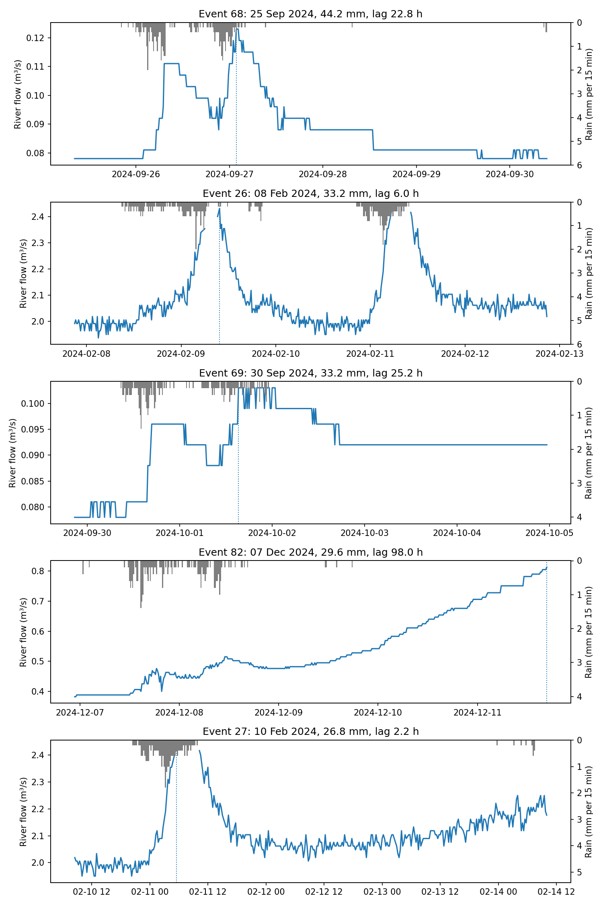
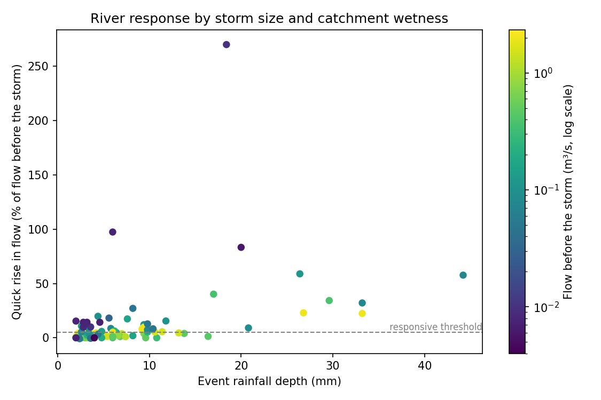
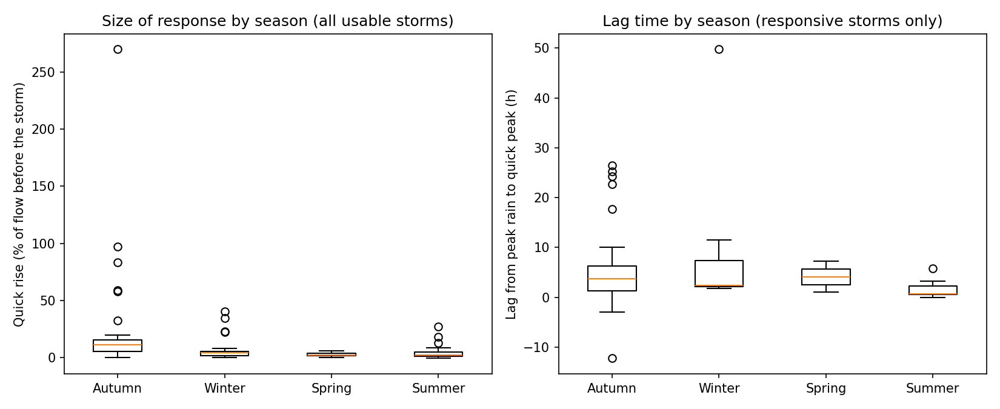
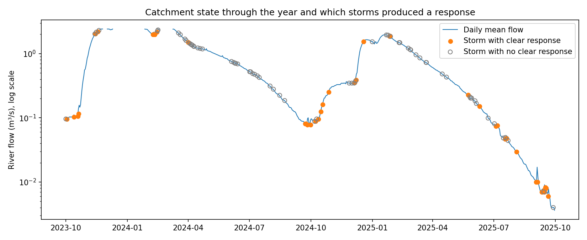

# Rainfall Event Analysis for the River Hull Catchment

How does a chalk headwater stream respond to individual storms, and what controls that response?

This project builds a reproducible pipeline that downloads open Environment Agency monitoring data, quality assures it, separates the rainfall record into individual storm events, and measures the river's response to each one.

**Study site:** Driffield rain gauge and Little Driffield flow gauge on Elmswell Beck, a headwater of the River Hull in East Yorkshire. The two gauges are about 1 km apart.
**Period:** two hydrological years, October 2023 to September 2025, at 15 minute resolution.

## Key findings

1. **Most storms produce no clear river response.** Of 109 usable storms, only 42 (39%) raised flow by 5% or more within 24 hours of the rain ending. The median storm delivered just 4.2 mm of rain.

2. **When the river does respond, it responds quickly.** The median lag from peak rainfall to the quick river peak was 2.5 hours. Some large winter storms also show a second, much slower rise lasting several days, the signature of groundwater released from the chalk (Figure 1).

3. **The catchment's state changes dramatically through the year.** Flow before storms ranged from about 0.08 m³/s at the end of summer to about 2 m³/s in winter, roughly a 25 fold difference, driven by groundwater stored in the chalk (Figure 4).

4. **How response is measured changes the conclusion.** In absolute terms (m³/s), the largest rises occurred in winter. As a percentage of the flow before the storm, autumn was the most responsive season, with 74% of storms responding compared with 36% in winter and 8% in spring. The quick storm runoff is fairly modest all year; what varies is the groundwater flow it sits on. Reporting only one measure would give a misleading picture.

5. **Storm depth matters more than intensity.** Spearman correlations with the percentage rise were 0.49 for storm depth, 0.33 for peak intensity, 0.23 for rain in the previous 7 days, and minus 0.24 for flow before the storm. This is consistent with a permeable chalk catchment where most rain infiltrates rather than running off.

| Season | Usable storms | Responsive storms | Median flow before storm (m³/s) | Median quick rise (%) |
|---|---|---|---|---|
| Autumn | 34 | 25 (74%) | 0.088 | 10.9 |
| Winter | 22 | 8 (36%) | 1.536 | 3.9 |
| Spring | 24 | 2 (8%) | 1.214 | 2.2 |
| Summer | 29 | 7 (24%) | 0.186 | 1.9 |

## Figures


*Figure 1. The five largest storms. Grey bars: rainfall. Blue line: river flow. Dotted line: quick peak.*


*Figure 2. Storm depth against percentage rise in flow, coloured by flow before the storm.*


*Figure 3. Size of response and lag time by season.*


*Figure 4. Daily flow through both years, with each storm marked as responsive or not.*

## Data quality assurance

Real sensor records are imperfect, so quality assurance is a core stage of the pipeline rather than an afterthought. The full report is in [`reports/qa_report.md`](reports/qa_report.md). In summary:

| Check | Rainfall | River flow |
|---|---|---|
| Readings flagged Suspect by the EA (removed) | 8,878 | 8,180 |
| Readings missing from the download | 24 | 0 |
| Single point spikes removed | n/a | 171 |
| Flat periods of 24 h or more (flagged, kept) | n/a | 77 |
| Short gaps filled by interpolation (up to 1 h) | n/a | 478 |
| Usable record after QA | 87% | 89% |

One lesson from this stage: **QA rules must be tuned to the system being measured.** Flat periods of a day or more would usually suggest a stuck sensor, but this groundwater fed stream genuinely changes very slowly, so these periods were flagged for review rather than deleted.

## Method

| Stage | Script | What it does |
|---|---|---|
| 0 | `src/find_stations.py` | Lists rainfall and river stations near the study area |
| 2 | `src/download_data.py` | Downloads the 15 minute series from the EA Hydrology API |
| 3 | `src/quality_checks.py` | Removes duplicates, regularises to a 15 minute grid, applies EA quality flags, removes impossible values and spikes, flags flat lines, fills only short gaps |
| 4 | `src/events.py` | Separates storms using a 6 hour dry gap and a 2 mm minimum depth |
| 5 | `src/event_stats.py` | Measures flow before each storm, the quick peak within 24 h of rain ending, the delayed rise within 72 h, and lag time for responsive storms |
| 6 | `src/make_figures.py` | Produces the figures and [`reports/summary.md`](reports/summary.md) |

All settings live in `src/config.py`. Lag times are only calculated for storms with a clear response, because for storms with no real response the highest reading in the window is just noise.

## Limitations

1. **Much of the data is provisional.** About half of the rainfall readings were still marked Unchecked by the Environment Agency, mostly in the second year.
2. **Some peaks are missing.** In several large storms, readings at the top of the peak were flagged Suspect and removed, so some peak flows may be underestimated.
3. **A single rain gauge** represents rainfall over the whole catchment, which will miss local variation, especially in summer convective storms.
4. **Event definition affects results.** Two bursts of rain joined by drizzle can be treated as one storm, which lengthens the measured lag.
5. **The 5% response threshold is a judgement.** At low flows it is close to the resolution of the flow record.
6. **Small samples in some seasons.** Spring had only 2 responsive storms and summer 7, so their lag times are not reliable.
7. **Correlations are simple.** Season, storm depth and catchment wetness are linked to each other, so these correlations show association, not cause.

## Relevance to sustainable drainage (SuDS) monitoring

The central finding here, that the same storm produces very different responses depending on the state of the system, is the same problem faced in managing bioswales and other SuDS. A bioswale's available capacity depends on how much water it already holds, how wet the soil is and how fast it is draining, not just on the incoming storm.

The pipeline transfers directly to SuDS monitoring data. With a rain gauge and water level or soil moisture sensors in a bioswale, the same stages would quality assure the sensor records, separate storm events, and measure peak attenuation, lag time and available storage for each event. The lessons from this project also carry over: QA thresholds must suit the system, response metrics must be chosen carefully, and conclusions should be checked against more than one measure.

## Future work

1. Separate quick runoff from baseflow formally using a baseflow separation method.
2. Add a simple water balance model of the catchment.
3. Compare with a less permeable, faster responding catchment nearby.
4. Test how sensitive the results are to the dry gap and response threshold settings.

## How to run

```
pip install -r requirements.txt
python src/find_stations.py
# paste your chosen station ids into src/config.py
python src/run_pipeline.py
```

## Data licence

Contains Environment Agency data licensed under the Open Government Licence v3.0.

## Author

Abimbola Emmanuel Omowumi, MSc Artificial Intelligence and Data Science, University of Hull
